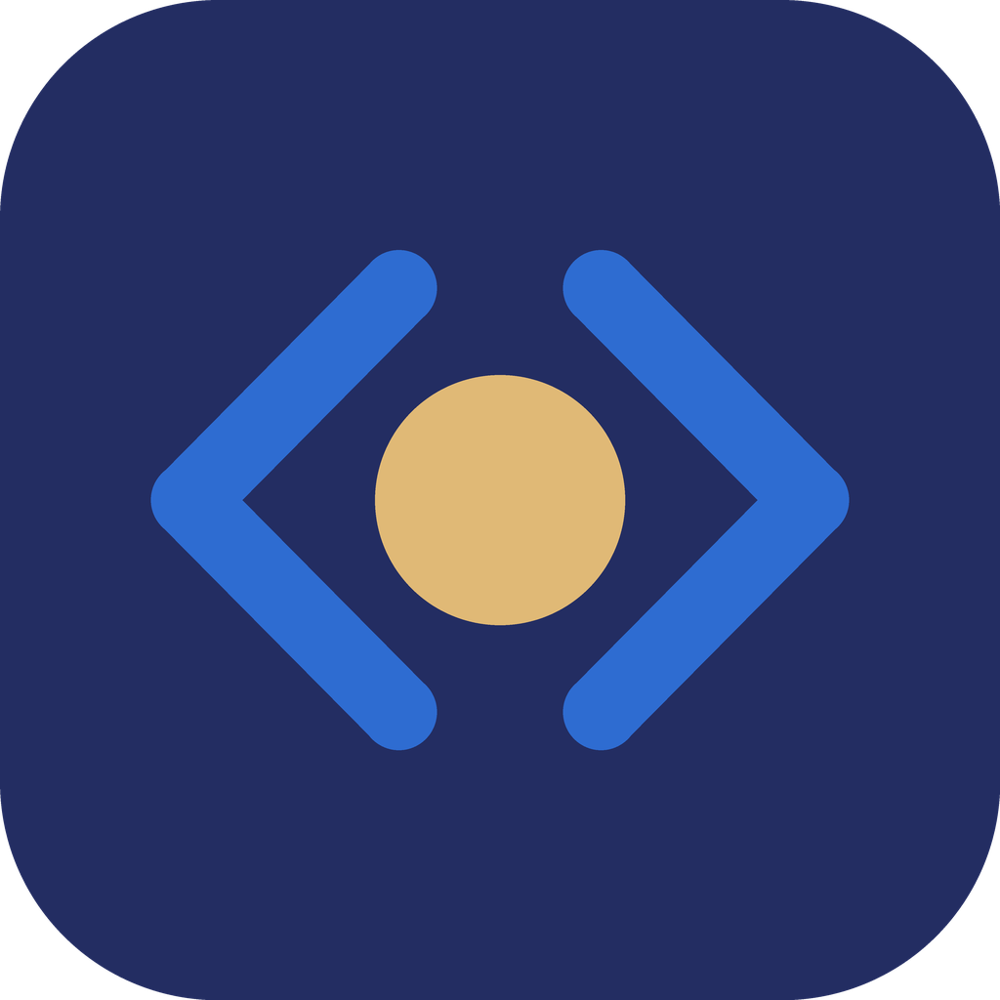

<p align="center">
  
</p>

<h1 align="center">Niwala</h1>

<p align="center"><b>VS Code + opencode, in one open-source editor.</b></p>

Niwala combines **[VS Code](https://github.com/microsoft/vscode)** (Code - OSS) and **[opencode](https://github.com/anomalyco/opencode)**, the open-source AI coding agent. You get the full VS Code editor with opencode built in, and GitHub Copilot removed.

- **opencode built in.** It starts with the editor. Open it from the activity bar (`Ctrl/Cmd+Esc`) or in an editor tab with **opencode: Open in Editor**.
- **No Copilot.** The Copilot extension and the built-in Copilot chat UI are removed.
- **Private by default.** opencode runs locally on `127.0.0.1` with a random password for each window.
- **Open source.** It builds on two MIT-licensed projects, and every change is published.

## The name: Niwala (निवाला)

*Niwala* means a single **bite of food**, the morsel you pick up from a meal with your hand.

The name is a tribute to the children in India who died from malnutrition, children who did not get even one niwala. Money that should feed the underprivileged is being spent by the ruling BJP–RSS on building temples. This project is dedicated to those children, and it is a reminder that a meal matters more than a monument.

## Getting started

Clone the repository with its submodules:

```sh
git clone --recurse-submodules https://github.com/Lucky-Rathore/niwala.git
cd niwala
```

Then build and run:

```sh
./build.sh dev                         # build and launch from source on this machine
./build.sh package linux x64           # packaged app -> ./VSCode-linux-x64
./build.sh package darwin arm64        # run on macOS
./build.sh package win32 x64           # run on Windows (Git Bash)
```

**Requirements:** Node (version in `vscode/.nvmrc`) and [Bun](https://bun.sh) (version in `opencode/package.json`, under `packageManager`).
On Linux you also need: `sudo apt-get install -y libx11-dev libxkbfile-dev libsecret-1-dev libkrb5-dev`.

## Repository layout

| Path | What it is |
|---|---|
| `vscode/` | Submodule: [niwala-vscode](https://github.com/Lucky-Rathore/niwala-vscode), a fork of microsoft/vscode (branch `niwala`) |
| `opencode/` | Submodule: [niwala-opencode](https://github.com/Lucky-Rathore/niwala-opencode), a fork of anomalyco/opencode (branch `niwala`) |
| `build.sh` | Builds opencode, bundles it into VS Code, and packages the app |
| `branding/` | Logo and icon generator |

## How it fits together

`vscode/extensions/opencode` is a built-in extension. On startup it launches the bundled
`opencode serve` on `127.0.0.1` with a random password for each window. It then shows opencode's web UI,
which is embedded in the binary, in an **opencode** activity-bar view (`Ctrl/Cmd+Esc`), or in an editor
tab via **opencode: Open in Editor**.

## Changes to upstream

**vscode/**
- `product.json`: renamed to Niwala (app name, data folders, bundle/app IDs, URL protocol). Copilot is removed from the trusted-auth and auto-update lists.
- `extensions/copilot`: deleted. The build scripts are adjusted to work without it: `package.json` (compile/watch scripts), `build/npm/dirs.ts`, `build/next/build-fast.ts`, `build/lib/copilot.ts` (skips the ripgrep shim when the extension is absent).
- `chat.disableAIFeatures` defaults to `true` (`src/vs/workbench/contrib/chat/browser/chat.shared.contribution.ts`), which hides the built-in Copilot chat UI. `defaultChatAgent` stays in `product.json` because workbench code reads it without a guard.
- `extensions/opencode`: new. It is registered in `build/gulpfile.extensions.ts` and `build/npm/dirs.ts`, and `build.sh` fills its `bin/` folder.

**opencode/**
- `OPENCODE_PUBLIC_UI=1` (new, opt-in; `packages/core/src/flag/flag.ts`, `packages/opencode/src/server/shared/public-ui.ts`): serves the static web UI without auth so it can load inside a webview iframe. The API is still password-protected, and the UI authenticates with `?auth_token=`.

## Branding

`branding/generate-icons.py` redraws the logo (`branding/niwala.svg`) and regenerates the app icons in
`vscode/resources/{linux,darwin,win32,server}`. To change the logo, edit the geometry and colors there and re-run it.

## Roadmap

- Windows installer artwork (`vscode/resources/win32/inno-*.bmp`) is still the Code - OSS art.
- Some UI text, license URLs, and `reportIssueUrl` still say "Copilot" or "Code - OSS".

## Contributing

Issues and pull requests are welcome.

## License

MIT. Niwala builds on [VS Code](https://github.com/microsoft/vscode/blob/main/LICENSE.txt) (MIT) and
[opencode](https://github.com/anomalyco/opencode/blob/dev/LICENSE) (MIT). Their licenses and notices apply to their code.
